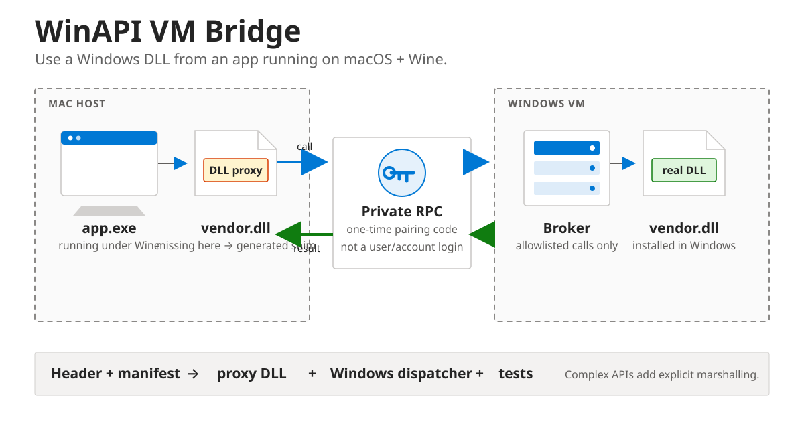

# WinAPI VM Bridge



> **Research preview—not production ready.** The real Windows DLL round trip
> works. Packaging, transport hardening, generated production adapters, and
> clean-machine qualification are still incomplete.

Use a DLL that exists in Windows from an app running under Wine on macOS. The
app stays on the Mac. A generated proxy DLL exposes the missing exports, sends
selected calls to the real DLL inside a Windows VM, and returns the native
result.

> **This calls a real Windows DLL—not a ping or mock.** The third command invokes
> `kernel32.dll!GetTickCount64` inside the Windows VM and returns the native
> unsigned 64-bit result to the Mac. The Windows CI job runs this exact call.

## Try the bridge

**Windows PowerShell**

```powershell
irm https://raw.githubusercontent.com/dragoshont/winapi-vm-bridge/main/setup-windows.ps1 | iex
```

**Mac**

```bash
curl -fsSL https://raw.githubusercontent.com/dragoshont/winapi-vm-bridge/main/setup-mac.sh | bash
```

Mac setup verifies an existing pairing first. If it still works, setup reuses it
without prompting. A new code is requested only when no pairing exists or the
broker rejects the stored one.

**Call a real Windows DLL**

```bash
winapi-vm-bridge call windows.kernel32.GetTickCount64 --json
```

Windows prints a pairing code once. Paste it into the Mac setup prompt. The
third command then calls the real `kernel32.dll!GetTickCount64` export inside
the Windows VM and returns its native unsigned 64-bit result to the Mac.

## First-time pairing

Pair the **Mac and Windows VM once**, not once per DLL.

The Windows setup creates one random capability. The Mac setup stores it with
restricted permissions and verifies it against the broker. Every installed DLL
adapter uses that same private transport.

Pair again only when:

- connecting a different Mac or Windows VM;
- rebuilding or resetting either side;
- rotating a capability that may have been exposed.

Adding another DLL means installing its manifest, proxy, and dispatcher. It
does not require a new pairing code.

Pairing is transport access control. It is not user, Microsoft, application, or
account authentication.

## How it works

```text
app.exe → shim.dll → private RPC → Windows broker → vendor.dll
app.exe ← shim.dll ← private RPC ← Windows broker ← vendor.dll
```

1. Describe the DLL exports in a strict adapter manifest.
2. Generate a Wine-side shim and Windows dispatcher review bundle.
3. Implement custom marshalling only where the ABI needs it.
4. Validate one complete operation in the real application.

## Build an adapter

```bash
winapi-vm-bridge init vendor.library
winapi-vm-bridge generate adapter.json --out generated
cat generated/vendor-library/IMPLEMENTATION_TASK.md
```

The generated task is designed for either a developer or a coding agent. It
includes the contract, unresolved marshalling work, tests, and stop conditions.

## Where it fits

Best for coarse request/result calls:

- account and public-profile APIs;
- store, catalogue, entitlement, and licensing checks;
- achievements, presence, and cloud saves;
- Windows-only HTTP/signing SDK clients;
- proprietary codecs, conversion, and document processing;
- scientific, industrial, and device-management SDK queries that do not need a
  kernel driver.

### Works well

- scalar arguments and fixed-layout structs;
- bounded input/output buffers;
- UTF-8 and UTF-16 strings;
- opaque remote handles;
- coarse synchronous or async request/result APIs.

### Needs custom marshalling

- nested pointers and allocator ownership;
- callbacks, COM, thread affinity, and window messages;
- shared memory and process-local handles;
- bespoke cancellation or async lifecycles.

### Out of scope

- kernel drivers and anti-cheat;
- per-frame graphics calls;
- undocumented ABIs;
- arbitrary client-selected DLL paths or exports.

## What is included

- capability-paired, versioned RPC core;
- Windows broker and Mac client;
- adapter JSON schema and generator;
- generated shim/dispatcher skeletons;
- AI-ready implementation prompt;
- bounds, pairing, and round-trip tests;
- three-command setup and rollback guidance.

## Status

| Capability | Status |
|---|---|
| Paired Mac ↔ Windows VM RPC | Working |
| Real `kernel32.dll!GetTickCount64` round trip | Working on Windows |
| Portable `core.ping` health check | Working |
| Adapter schema and patch generator | Working |
| Generated review/test bundle | Working |
| Compilable scalar shim/dispatcher generation | [Planned](https://github.com/dragoshont/winapi-vm-bridge/issues/1) |
| Complex API adapters | Per library |
| Transparent arbitrary-DLL remoting | Not supported |

## Production readiness

Before calling this production-ready, the project still needs:

- encrypted and mutually authenticated transport, not capability-only access;
- signed/notarized Mac and signed Windows release artifacts;
- installers and rollback that do not depend on Python or a source checkout;
- automatic or fully guided VM networking/forwarding;
- compilable generated shim and dispatcher output;
- protocol compatibility/version migration guarantees;
- clean-machine Mac ↔ Windows VM end-to-end tests;
- fuzzing, threat modelling, dependency/provenance checks, and security review;
- crash recovery, update, rotation, multi-client, and observability behavior;
- at least one independently built real-library adapter beyond the system-DLL
  proof.

## Read next

- [Architecture](docs/architecture.md)
- [Generic adapter model](docs/generic-adapters.md)
- [Adapter guide](docs/adapter-guide.md)
- [Evidence method](docs/evidence.md)
- [SDK](sdk/README.md)
- [Security](SECURITY.md)

Independent research. The project does not ship third-party SDKs, DLLs,
credentials, application files, or private configuration. Use only libraries
and systems you are authorized to use.
