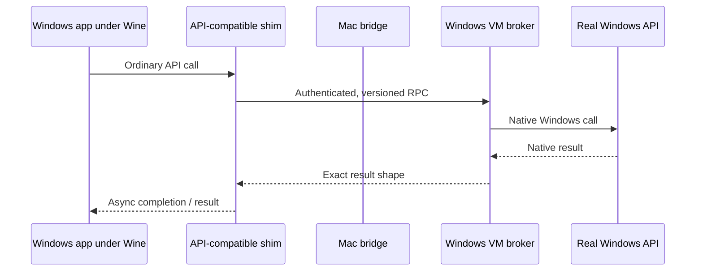

# WinAPI VM Bridge

A generic RPC framework for calling **Windows DLL exports** from an application
running through Wine/CrossOver on macOS, using a Windows VM as the API
coprocessor.

> Status: research proof and adapter SDK, not transparent arbitrary-DLL
> remoting. A real application request crossed Mac → Windows VM → Mac and the
> original caller consumed the native result. This does not prove compatibility
> for every DLL, graphics acceleration, kernel-driver support, anti-cheat, or
> Wine/CrossOver replacement.

## Three-command quickstart

On Windows PowerShell:

```powershell
irm https://raw.githubusercontent.com/dragoshont/winapi-vm-bridge/main/setup-windows.ps1 | iex
```

On the Mac:

```bash
curl -fsSL https://raw.githubusercontent.com/dragoshont/winapi-vm-bridge/main/setup-mac.sh | bash
```

Verify the round trip:

```bash
winapi-vm-bridge call core.ping --json
```

The setup commands are intentionally fail-closed. They install the source
checkout and run the portable authenticated `core.ping` broker without
downloading unverified binaries. Native DLL adapters additionally require their
authorized Windows SDK/runtime, real DLL, verified hash, and adapter manifest.

## Architecture



The game remains on the Mac. A generated or hand-written **shim DLL** exports
the functions the application expects. The shim serializes calls to the VM,
where the broker loads the allowlisted real DLL, invokes its export, and returns
the result.

```text
game.exe → generated shim.dll → RPC → VM broker → real vendor.dll
game.exe ← generated shim.dll ← RPC ← VM broker ← real vendor.dll
```

Each adapter manifest describes the library, export signatures, structures,
buffer directions, handle types, calling convention, errors, and timeouts.

## What can be generic?

Manifest-driven without custom code:

- scalar arguments and returns;
- fixed-layout structs;
- bounded input/output buffers;
- UTF-8/UTF-16 strings;
- opaque handles represented by remote IDs;
- synchronous or ordinary async request/result APIs.

Custom marshalling plugin required:

- nested pointers and allocator ownership;
- callbacks, COM interfaces, window messages, and thread affinity;
- shared memory and process-local OS handles;
- APIs with bespoke async or cancellation behavior.

Not supported as transparent arbitrary remoting:

- kernel drivers and anti-cheat;
- high-frequency graphics/per-frame APIs;
- undocumented exports without a trustworthy ABI definition.

See [architecture](docs/architecture.md), [evidence](docs/evidence.md), and the
[adapter guide](docs/adapter-guide.md).

## Security model

- Capability-authenticated local transport.
- Versioned operation allowlist; no arbitrary DLL export invocation.
- Genuine API results only; never fabricate success.
- Treat each output by sensitivity. Identifiers/public profile data can be
  returned when required. Tokens and signatures require exact scope, lifetime,
  bounded in-memory handling, and must never be logged.
- No passwords, private keys, DRM bypass, or unrelated account access.

## Adapter manifest

```yaml
adapter: example.math
windows:
  dll: vendor.dll
exports:
  - name: VendorAdd
    callingConvention: stdcall
    parameters:
      - { name: left, type: i32, direction: in }
      - { name: right, type: i32, direction: in }
    returns: i32
```

The toolchain generates:

- a Windows-compatible shim DLL for Wine;
- broker dispatch/marshalling code;
- schema validation and adversarial tests;
- CLI calls such as `winapi-vm-bridge call example.math.VendorAdd`.

See [generic adapter design](docs/generic-adapters.md).

## Adapter independence

The core repository is vendor- and application-neutral. Case studies belong in
evidence documents or separate adapter repositories. The core does not ship
third-party SDK headers, libraries, credentials, application files, or private
configuration.

## Project status

| Capability | Status |
|---|---|
| Framed authenticated RPC | Proven |
| Real game user-add round trip | Proven |
| Generated adapter review bundle | Implemented |
| Portable authenticated `core.ping` | Implemented |
| Compilable generated scalar shim/dispatcher | Tracked in issue #1 |
| Sensitive async-result pattern | Tracked in issue #2 |
| Arbitrary Windows DLL remoting | Out of scope |

## Legal

Independent research; not affiliated with Microsoft, Xbox, Apple, CodeWeavers,
UTM, or the tested game publisher. Third-party SDKs and products retain their
own terms. Use only accounts, titles, and systems you are authorized to use.
