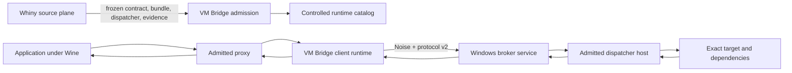
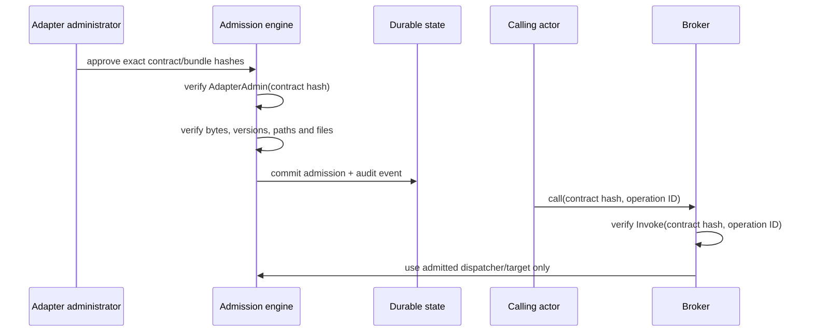

# Runtime architecture

## Product boundary



Whiny owns inspection, semantic evidence, canonical contract/IR, dependency
placement, freezing and every generated artifact. VM Bridge owns execution.
There is no second contract implementation in this repository.

## Frozen artifact admission

The current boundary identifiers are:

- `whiny.frozen-adapter-handoff.v1`;
- `whiny.authority-registry.v1`;
- `whiny.adapter-contract.v3`;
- `whiny.adapter-bundle.v1`;
- `whiny.dispatch.v1`;
- `whiny.correlated-runtime-expectations.v1`;
- `whiny.correlated-runtime-admission.v1`;
- `whiny.scalar-test-authority-registry.v1`;
- `whiny.scalar-frozen-adapter-handoff.v1`;
- `whiny.scalar-correlated-runtime-expectations.v1`;
- `whiny.scalar-correlated-runtime-admission.v1`;
- `whiny.runtime-receipt.v1`.

The v2.5 consumer is pinned to Whiny revision
`c48db610ef2e9505b0fbc577a76704a1214bc83f`. It binds the canonical handoff,
registry entry, contract, bundle, deterministic build receipt, dispatcher,
provider, candidate, operation/schema IDs, side-effect policy, challenge
policy, acceptance command, source revision and custody boundary. It does not
generate, qualify or repair any of them.

An admitted bundle is not trusted because it was generated. Admission requires
an independently authorized operator and verifies:

1. exact contract and bundle descriptor bytes and SHA-256 values;
2. exact contract, bundle and dispatcher ABI identifiers and majors;
3. exactly one dispatcher and target;
4. every target and dependency hash;
5. a bounded operation set;
6. portable controlled relative paths;
7. no path traversal, case collision, symlink, junction or reparse point;
8. canonical containment under the configured package root.

The verified paths are re-resolved and re-hashed before loading. The Windows
loader uses explicit package directories and secure `LoadLibraryEx` search
flags; ambient `PATH` and current-directory resolution are prohibited.

Admission and invocation are separate:



Bundle metadata cannot create an actor, role or grant.

The public Whiny v1 authority registry and handoff currently describe only
`development-only` evidence. Their challenge, sequence and correlation values
are `unsupported`, and correlated admission reports `runtime_support: false`.
VM Bridge may bind and retain that evidence, but an `Invoke` grant cannot turn
it into runtime authority. T16, T26 and T32 therefore remain unsupported, and
the older scalar bundles cannot traverse the v2.5 handoff until Whiny publishes
reviewed scalar authority, handoff and runtime-expectation artifacts with
supported pre-execution controls. The old v0.3 bundle path remains historical
compatibility, not a substitute for this missing authority.

The separate scalar test-authority consumer is pinned to merged Whiny main
`f968659d4cee38bb30595e776e796cba45a611cc`. The schema and metadata surface is
byte-identical to reviewed producer `67884aca55fe359243340bb59f644d80738c41b0`;
the later main commit additionally includes the exact native and managed target
DLL bytes already named by those reviewed identities.
Its manifest SHA-256 is
`6bd6c8eee2e55bc30a8bbaa754a3b1fcd7eb4bd2e2402eac931f410e7d4196e8`,
its registry SHA-256 is
`b39d8c49da636262f18ab19058c655519c60cf8797d26de82dd93778bfc30298`,
and its retained source-evidence manifest SHA-256 is
`2fb90b2192980f8b87f2386a1e7009b7bff5d089e121fdead03882a4f7d54734`.
It is a distinct, scalar-only exception for bounded native and managed test
execution. It binds Whiny's own manifest, registry, handoffs, correlated
expectations/admissions, retained source evidence, signed receipts and
acceptance-only trust policy. It retains only the SHA-256 identity of Whiny's
consumed replay state; private replay state is not packaged or imported.

Scalar authorization remains `test-execution-authorized`,
`bridge-owned-invoke-required`, `development-only`, `support_claim: none` and
`runtime_support: false`. A separately authenticated Bridge `Invoke` grant must
match the exact contract hash and operation before the consumer returns a
test-execution authorization. This does not create actors, roles, grants, ACLs
or credentials, does not become product qualification, and does not alter the
v1 denial or the unsupported status of T16, T26 and T32.

## Runtime layers

### Wine/client side

`wvb-provision create ACCOUNT` is a macOS-only, create-only client configuration
prerequisite, not pairing. It is built by
`native/macos-keychain/build-and-test.sh` and included in new macOS runtime
packages as `bin/wvb-provision` (no change to existing installed packages).
For source-only build/API-double checks without touching Keychain, use:

```sh
WVB_BUILD_OUT="$PWD/out/provision-source" \
  sh native/macos-keychain/build-and-test.sh --source-only
```

The operator command is:

```sh
authorized-record-producer | /absolute/path/to/wvb-provision create ACCOUNT
```

`authorized-record-producer` denotes the operator's **already authorized**
secure producer, not a shipped executable or a pairing implementation. It must
write exactly one existing native `WvbKeychainRecordV1` binary record to its
private anonymous stdout pipe, close it, and securely erase its own copies.
Do not substitute a secret literal, shell expansion, environment variable or
plaintext file. No source of authorized record bytes or active endpoint is
invented by this command. `ACCOUNT` is a nonsecret selector of 1–127 printable
ASCII bytes excluding spaces/control characters; it is not logged or hashed.
There is no file, export, overwrite, delete, reset or key-generation option.

The command accepts only an owned anonymous stdin pipe (not a terminal, file
or named FIFO), with one five-second deadline covering all input and EOF.
Short/extra input fails; at most `sizeof(WvbKeychainRecordV1)+1` bytes are read.
Shared runtime validation checks the existing magic, version, ACTIVE state,
nonempty bounded NUL-terminated broker address and nonzero connect/call budgets
**before** any Keychain operation. These are existing record rules, not proof
of a numeric reachable endpoint, valid keys, actor authorization or admission.
No record layout, runtime-v2 service or Wine/client ABI changes.

Creation uses one `SecItemAdd`, never lookup/update/delete: a duplicate selector
fails atomically without reading or replacing its existing secret. The dedicated
CLI process disables Security interaction before creation; the add request also
requires authentication-UI failure, so locked/denied/auth-required stores fail
without an interactive prompt. The C Security compatibility selectors are
deprecated on recent SDKs but intentionally retained here; no Objective-C
authentication context or new runtime dependency is introduced.
Only fixed `created`, `selector exists`, `invalid input`, `noninteractive policy
failed`, or `create failed` messages are emitted. Exit codes are 0 (created),
64 (input/usage), 65 (policy/create failure), and 74 (output failure).
No account, address, key, record bytes, OS error details or digest are emitted.

The input buffer is volatile-erased on every return path; the CFData passed to
Security borrows that buffer without a second application-owned key copy.
The producer remains responsible for its storage. OS/Keychain-internal copies
and IPC duration are not controlled or proven erased by this command; the
five-second bound is on input, not a cancellable Keychain transaction. A broken
receipt/output after add does not prove creation failed: do not automatically
retry, overwrite or delete. No runtime provisioning was performed by source
checks. This prerequisite alone does not establish pairing, forwarding, setup,
app execution or runtime acceptance.

- process-wide connection pool per broker identity;
- no blocking or network work in `DllMain`;
- bounded call and transfer queues;
- guarded ABI copies and exact error restoration;
- explicit callback executors;
- inherited sessions discarded after fork;
- OS-backed identity consumed without plaintext repository or registry secrets.

The failed CrossOver by-name unixlib experiment is not a supported
configuration path. The source composition now loads `wvb_autoconfig.dll` with
`LoadLibraryExW`. Its `DllMain` calls Wine's `__wine_init_unix_call`; the exported
configuration function subsequently uses `WINE_UNIX_CALL` with that initialized
handle to read the existing Keychain record. There is no by-name Unix-library
load or numeric private memory-information-class probe. No credential read or
network connection occurs in `DllMain`. Missing initialization/export/record
fails explicitly, and failed reads leave the caller's configuration unchanged.

The same x64 builtin now exports the five existing `native/include/wvb_client.h`
functions: configure, bind-operation, call, call-ex and reset. Private in-process
Unix-call arguments forward their exact pointers, sizes and client statuses to
the real host Rust client; they are not a new remote wire format or codec.
Configuration remains explicit: merely loading the DLL or reading its config
export does not configure/bind the client or make an unavailable connection
successful. Unix-call failure returns `WVB_STATUS_RUNTIME_ERROR`, never success;
call lengths/dispatch outputs are zeroed on that failure. A completed Unix call
preserves the host client's separate `WvbStatus`, dispatch status, required
capacity and opaque response bytes. Generated proxies still validate and
restore declared target HRESULT/last-error from the operation-specific body.
The original configuration entry remains index0. Pointer-bearing client calls
require the reviewed native x64 layouts; their WOW64 entries explicitly return
`STATUS_NOT_SUPPORTED` without dereferencing arguments.

`native/wine-unixlib/build-and-test.sh` runs source composition tests against a
mock Wine SDK and cross-builds the PE caller without launching Wine or accessing
Keychain. To also build the x64 builtin pair, select the exact runtime's installed
Wine SDK with `WVB_WINEGCC=/absolute/path/to/winegcc`; set
`WVB_REQUIRE_BUILTIN_BUILD=1` to fail rather than skip an unavailable SDK.
The selected SDK build also builds the real `wvb-client-ffi` x64 Rust static
archive, locked/offline, with Cargo's target directory confined to
`$WVB_BUILD_OUT/host-client`; it does not change a shared Cargo target or
installed runtime. `WVB_HOST_CLIENT_LIB` may select an already built actual
x64 static archive; a dylib or arm64 library is rejected, not substituted.
The Unixlib incorporates all five existing client functions, while exporting
only its existing Unix-call tables and config entry. The script checks all
six actual PE exports and the import library's `wvb_autoconfig.dll` binding. The
native Windows `wvb_client_ffi.dll` remains a different artifact/path, not this
Wine builtin. No client DLL naming fallback or implicit configuration is used.
Set `WVB_WINEBUILD` to the same SDK's `winebuild` if it is not next to
`WVB_WINEGCC`. That exact tool also handles the PE compilation and builds the
real import thunks directly from the authoritative `.spec` using `--implib`;
GNU linker's `--out-implib` is not sufficient for Wine-generated `.edata`.
The source gate links a never-executed PE consumer of all five client symbols
and inspects its actual `wvb_autoconfig.dll` imports. A DLL-name-only archive
must fail both the thunk guard and that consumer link; DLL-name inspection
alone does not establish a usable archive.
The PE build uses Wine's builtin marker and CRT initialization support; the
matching Mach-O unixlib exports the existing Unix-call table. Output is staged
under `out/wine-unixlib-static/lib/wine/{x86_64-windows,x86_64-unix}`.
Set `WVB_BUILD_OUT` to a separate absolute directory inside this worktree's
`out/` when preparing new candidates without replacing runtime-pinned artifacts.
The generated import library is `x86_64-windows/libwvb_autoconfig.dll.a`.
The Unixlib install name is `@loader_path/wvb_autoconfig.so`. Its real Rust
client is statically included, so the two Wine files no longer depend on an
absolute Cargo dylib or an additional client DLL. Required dynamic dependencies
are the system Security/CoreFoundation frameworks, libiconv and libSystem;
Rust's native static link requirements are supplied by clang's implicit
libSystem plus explicit iconv/c/m. Inspection rejects extra dependencies,
loader-search paths, missing static client functions or leaked Rust exports.
Source checks copy the real pair/import archive/calling fixture to a separate
`relocated-candidate` artifact directory, check unchanged bytes/closure, and
link native Unix-call and all-five PE consumers against that copy without
loading it. A changed existing relocation destination fails closed; choose
a fresh output root for a different candidate. Historical runtime-pinned
dylib-linked artifacts are not rewritten by this change.
Source/mock compilation and relocation/link checks do not establish
installed-engine loading, guest faults, configured RPC, generated-proxy or
application acceptance.

The script also builds, but does not execute, `out/wine-unixlib-static/loader_probe.exe`.
This synthetic caller loads the builtin, resolves its configuration export
without calling it, prints the Windows module path/PID, holds for ten seconds
for separately scoped mapping observation, and unloads. It does not invoke
Keychain or configure Bridge. With one explicit absolute Windows proxy path,
the same probe instead loads that generated DLL and resolves `add` without
calling it, preserving the observation hold and unload. Source mocks cover
both modes and assert that neither resolved export is ever invoked.
Its virtual module path alone is not proof of
the staged Unixlib identity. It uses default DLL search flags for diagnosis,
not a system32-only search that could mask staged builtin lookup. Actual use
still requires builtin-only per-process overrides, a builtin loader trace and
the exact staged Unixlib mapping; a search/layout failure is not ABI evidence.
Actual use requires an explicitly selected owned
prefix, scoped transient-server cleanup and runtime authorization; creating a
new Wine prefix is itself a mutation, not a source check.
`native/wine-unixlib/run-loader-probe.py` defaults to printing its plan and
requires explicit `--execute` only after separate target/operation/rollback
approval. Source checks parse its syntax and exercise its builtin-log predicate.
Mocked failure-path tests import it with temporary fixture paths and forbid
all subprocess execution; they cover partial directory creation, staging
copy/hash failures and unknown/replaced ownership. Each created directory's
identity is captured immediately. Pre-launch failures remove only a verified
owned partial tree without invoking wineserver; unknown/replaced identities
stop cleanup. These tests do not execute Wine or the actual runtime target.
Its runtime branch uses a newly owned
prefix and foreground server, captured child PIDs, exact staged Unixlib
mapping, input hashes and scoped cleanup; it is not an OS confinement promise
or a generated-proxy acceptance test.

`tests/scalar_call_probe.c` is a separately built **calling** source fixture,
not the noncalling loader probe. It explicitly configures the existing client
ABI with the local scalar helper's known synthetic identity and public key,
loads the actual generated proxy, starts its recorder, calls `add(20,22)` once,
requires 42, finishes recording, holds 10s for separately granted mapping
observation, resets and unloads. Its native source mocks cover setup/call/
recorder/reset/unload failures without Wine, real client calls or sleeping.
The SDK build compiles but never executes its PE; import inspection requires
only configure/reset from `wvb_autoconfig.dll`. Execution, local listening,
fresh-prefix initialization, process cleanup and retention/restoration still
need their own exact reviewed grant. The existing scalar helper uses a
synthetic typed target behind the production dispatcher-call handler, not a
Windows guest DLL; this fixture cannot establish real-guest/app acceptance.

The installed CrossOver runtime alone does not include this SDK here. A
source-only follow-on built the minimal SDK subset and the x64 pair from the
officially linked
[`crossover-sources-26.3.0.tar.gz`](https://media.codeweavers.com/pub/crossover/source/crossover-sources-26.3.0.tar.gz)
(SHA-256 `ac99c8ca4b3848f3e81784135f023df266b61c2345726ea55a50b3e030dd6872`).
Its Wine source identifies version 11.0 and LGPL-2.1-or-later. Only native
Wine build tools and x64 PE Wine CRT/ntdll/kernel32/msvcrt imports were built
in ignored component-local output; no Wine engine was built, installed or run.
System Bison 2.3 failed the source's version gate; an already installed Bison
3.8.2 supplied the supported alternative without installing anything.

This compile result is not proof that installed CrossOver 26.3.0 build 39832
has the same ABI or that its loader locates this staged pair. Compatibility,
authorized per-bottle composition/activation and a real load/invocation
receipt are still required for REQ-A08. This is x64-only
source work, not ARM64EC/WoW64 or real-app acceptance. The upstream reference
mechanisms are Wine 10.0's
[`wine/unixlib.h`](https://github.com/wine-mirror/wine/blob/wine-10.0/include/wine/unixlib.h),
[`winecrt0/unix_lib.c`](https://github.com/wine-mirror/wine/blob/wine-10.0/dlls/winecrt0/unix_lib.c)
and [`winegcc`](https://github.com/wine-mirror/wine/blob/wine-10.0/tools/winegcc/winegcc.c);
these references are not proof of a particular CrossOver ABI.

#### Client FFI operation and error contract

`native/include/wvb_client.h` preserves the existing configuration and scalar
call layouts. After connecting, composition must bind each operation's exact
contract hash, operation ID and request/response schema IDs using
`wvb_client_bind_operation`. These are the same reviewed IDs already consumed
by `OperatorAdmission` and the broker; they are not inferred from operation IDs
or negotiated by HELLO. Bindings are client configuration, not new admission
records or invocation grants. Missing bindings fail before sending. Identical
binding is idempotent, conflicting binding is rejected, and reset/reconfigure
clears bindings. The service still validates the supplied request schema
against its own operation metadata and authorizes invocation independently.

Both scalar entrypoints validate the response schema and the exact four-byte
little-endian `whiny.dispatch.v1` execution status before copying any body.
`wvb_client_call_ex` additionally exposes that signed dispatcher status:

| FFI result | Meaning and writes |
|---|---|
| `WVB_STATUS_OK` | Dispatch succeeded; opaque typed result bytes copied |
| `WVB_STATUS_DISPATCH_ERROR` | Nonzero dispatcher execution status; no body copied |
| `WVB_STATUS_PROTOCOL_ERROR` | Wrong response schema or malformed execution status; no body copied |
| `WVB_STATUS_OPERATION_NOT_BOUND` | No exact local operation binding; no request sent |
| `WVB_STATUS_RUNTIME_ERROR` | Connection, transport or runtime failure; no body copied |
| `WVB_STATUS_INSUFFICIENT_BUFFER` | Dispatch succeeded; required byte count returned, no body copied |

Response length is zero on failure except insufficient capacity. The separate
dispatcher status is meaningful only on OK, insufficient capacity or dispatch
error. A target HRESULT/Win32 error is **not** the dispatcher execution status:
a legitimate failing HRESULT in a successful dispatch body is copied unchanged.
Generated proxies must check exact body size, decode the declared return/error
domain and apply the contract's output-write rules; an opaque byte FFI cannot
infer these. Do not automatically retry a failed or undersized call: the target
may already have executed. Legacy `wvb_client_call` returns a dispatch error
without exposing its exact value; its signature is unchanged.

For generated-source composition tests, build the host FFI and the
`scalar_fixture_broker` example in `wvb-client-ffi`. The example takes four
arguments: contract SHA-256 hex, operation ID, request schema ID and response
schema ID (decimal integers). It binds only ephemeral loopback, prints one
ready JSON record with deliberately synthetic client configuration, and exits
after 60 seconds. The test driver owns and terminates its exact subprocess.
Its production `DispatcherCallHandler` invokes a synthetic `i32(i32,i32)` target;
left arguments -1001 through -1008 select documented source-fixture API,
dispatch, framing and connection failures (see example source).
These test-only identities never authorize a real target. This helper is not
a guest service, generated proxy, Wine test, or runtime-acceptance substitute.

For generated byte-export source composition on macOS, the separate
`wvb-native-host` feature `source-fixture` exposes `SourceFixtureDispatcher`
and the `source_fixture_broker` example. Neither changes `NativeDispatcher`'s
default non-Windows rejection or advertises a new production runtime platform.
The fixture loader requires an absolute trusted dylib path and explicit
SHA-256 before loading the exact `whiny_dispatch_v1` symbol. The loaded
library owns that function's lifetime. It calls the exact shared invocation
and response-bound function used by the production Windows loader, allocating
the configured response capacity once with no size-probe/retry.

Build with `cargo build -p wvb-native-host --features source-fixture --example
source_fixture_broker`. Its arguments are absolute dispatcher library path, library SHA-256,
contract SHA-256, operation ID, request schema ID and response schema ID.
It emits the scalar helper's synthetic ready fields plus dispatcher identity
and fixed 1,048,576-byte response capacity; it uses ephemeral loopback, a
60-second lifetime and ten-second connection limits. The driver owns its exact
subprocess. An optional final `--one-connection` argument instead accepts exactly
one connection and propagates its actual handshake/`serve_calls` outcome to
process success or failure. A single 60-second deadline after readiness covers
accept, handshake and serving; the ten-second connection limit still applies.
Expiry is an error in this mode, not a successful idle shutdown. Successful
disconnect still requires a fully sent result and no incomplete or pending work.
These async bounds do not contain a hung native call or DLL unload. Without the
flag, the original multi-connection lifetime and connection logging are unchanged.
No contract parser, guessed bounded marshaller or fault guard is
provided. This can prove generated byte-export execution through the shared
host guard on macOS, not Windows PE loading, guest SEH/fault handling or app behavior.

The same opt-in example cross-builds for `x86_64-pc-windows-gnu` with
`cargo build -p wvb-native-host --features source-fixture --example
source_fixture_broker --target x86_64-pc-windows-gnu`. On Windows it uses the
existing real `NativeDispatcher`, never the Mach-O fixture loader or a mock.
The six explicit arguments, one-operation schema map, protocol-ceiling response
capacity, synthetic ready identities, Noise transport and bounded fixture
lifetime remain unchanged. Its Windows scope label explicitly identifies an
acceptance fixture, not a production service or application. Other platforms
fail closed; building without the opt-in feature does not enable the example.
Operation/schema IDs and dispatcher/contract hashes must come from the reviewed
generated packet; no scalar operation or four-byte capacity is assumed.
This fixture performs no durable actor/grant admission and its fixed test
identity/epochs/readiness are not production authentication policy. It adds no
public `serve` command, config/registry schema or secret-store integration.
Compilation is not a guest run: later authorized execution must establish
real loader/target identity, bounded/SEH results and process restoration.
The asynchronous connection timeout cannot preempt a blocked synchronous
native export; worker containment and production startup remain separate gaps.

Encrypted receive progress survives cancellation between broker result sends.
Only zero-byte EOF at a new physical-frame boundary with no unfinished logical
reassembly is classified as `TransportError::Closed`; a partial length header,
short ciphertext or EOF between logical fragments remains an explicit error.
The call broker treats that closure as normal only after a call result has
been fully sent and no incoming assembly or queued/running result remains.
Disconnect before any completed call or while call work is pending still fails.
The fixture therefore logs those failures unchanged, rather than ignoring an
`UnexpectedEof` string. This source distinction does not change the runtime
empty-stderr gate or retroactively classify a prior EOF receipt as idle.

The transport's 1,048,576-byte `LOGICAL_MAX` counts each `CallRequest.body`
and `CallResult.body` independently. Separate packed begin/data/end metadata,
the dispatcher status and transport/encryption envelopes do not consume this
body allowance; their own frame limits still apply. All generated prefix,
padding, reserved capacity and error/image trailer bytes inside a body do
count. An i32 result plus u32 native-error trailer therefore leaves at most
1,048,568 bytes for a returned bounded request image.

`NativeDispatcher` rejects zero or above-limit response capacity before
loading, rejects oversized request bodies before invocation, and rejects
reported result length beyond the allocated capacity. It never size-probes
by invoking the target twice. These byte-bound checks are not a guard against
an in-process DLL writing past its supplied pointer; generated platform
guards and the fault-containment policy remain separate.

REQ-A03 remains unaccepted. D-13 assigns complete codecs and typed thunks to
Whiny's generator over the existing byte dispatcher and operation/schema IDs,
with a real compiler/SEH gate first and an isolated-worker alternative if
that gate fails. Whiny's older bounded local prototype
`whiny_dispatch_bounded_v1` is not the byte dispatcher export
`whiny_dispatch_v1` resolved by `NativeDispatcher`. Descriptor primitives
alone do not compose complete framing, guarded typed invocation,
native-error/writeback or a connection-owned handle contract.
No pointer-bearing wire format or success-shaped bounded FFI stub is added.
REQ-N12 likewise retains the no-export rule: resident target/dependency
representation needs the coordinator's resolution of the admission freeze;
these changes do not copy a protected target or change any bundle schema.

### Transport/session

- framed TCP with `TCP_NODELAY`;
- Noise pairing and application sessions;
- HELLO/HELLO_ACK feature and bound negotiation;
- odd client stream IDs and independent multiplexed streams;
- bounded physical fragments and logical payloads;
- replay windows and actor-scoped rate limits;
- truthful timeout, cancellation and disconnect outcomes.

The configured client connect duration bounds TCP establishment, pinned Noise
handshake and HELLO activation together, without restarting the budget at stage
boundaries. A call's configured duration likewise covers command-queue wait and
response wait together. Caller timeout does not cancel remote execution, retire
the connection or prove that a native operation did not execute.

### Windows broker

- least-privileged service account;
- exact package ACLs;
- durable SQLite WAL state and bounded writers;
- separate liveness, readiness and diagnostics;
- actor/operation authorization on every dispatch;
- controlled native/CLR/process hosts;
- worker isolation and Job Object process-tree containment;
- startup reconciliation for admissions, operations and terminal receipts.

### Lifecycle

- transfers require begin/data/end, content hash and a terminal receipt;
- handles are bound to actor, epoch, slot, generation and type;
- callbacks enforce executor, thread, ordering, reentrancy and unregister rules;
- the first completion/cancellation terminal decision wins;
- disconnect during an executing non-idempotent operation produces
  `unknown`, never fabricated success or cancellation;
- process requests bound argv, environment, stdin, stdout and stderr and retain
  exact exit/timeout/cancellation results.

## Durable evidence

Runtime-changing operations have a durable operation UUID, actor, target hash,
timestamps, stage, attempt, idempotency hash, retry/cancel/rerun policy, trace
ID and terminal receipt. Events and receipts are hash chained. A trusted
rollback anchor remains independent of broker database metadata.

Before execution, a Runtime Owner attempt binds a nonzero workload, attempt and
receipt ID; exact host, bundle and operation; request and expected-response
hashes; immutable authorization-receipt and challenge hashes; and a monotonic
sequence. Terminal completion must match every prebound value. Assigning any of
them after execution is invalid rather than recoverable evidence.

`whiny.runtime-receipt.v1` defines the cross-product receipt format. VM Bridge
owns runtime emission, retention, privacy and query behavior; it does not own
Whiny build or semantic-evidence receipts.

## Package lifecycle

Unsigned packages have deterministic canonical manifests with exact source,
SBOM and file hashes. Installation uses inactive version slots:

1. verify and stage into a controlled temporary directory;
2. verify every copied file;
3. atomically finalize the version;
4. run health checks before activation;
5. retain the previous active slot for rollback;
6. refuse removal of the active slot;
7. expose exact uninstall impact before deletion.

Authenticode and notarization are separate external receipts. No signing secret
is stored in the repository or materialized by the runtime.

Bootstrap launchers are distributed and authenticated separately from runtime
archives. They are not embedded in the package they verify, avoiding a
self-authentication trust loop. The trusted launcher verifies the release
envelope before executing the envelope-bound lifecycle binary.

## Topology acceptance

The canonical topology remains Wine on macOS calling the Windows VM broker over
the approved forwarded TCP path. Shared memory, vsock, gRPC replacement, GUI
remoting, kernel/driver execution and anti-cheat bypass are not part of v2.

The isolated `Whiny-Windows11-x64` VM is the preferred acceptance target.
Acceptance automation must verify its UUID and readiness, record or snapshot
pre-state, use dedicated paths/rules/processes, and restore temporary changes.
The official Windows-RPC VM and unrelated VMs are never modified.

## Runtime Owner and host selection

The Runtime Owner API exposes typed install, activate, rollback, execute,
receipt-query and diagnostic operations only. Host discovery reports immutable
capability observations. Selection prefers compatible local Windows ARM64 work
and routes authoritative or x64-only profiles to authoritative Windows x64.

Workload UUID, attempt UUID, selected host, bundle hash and terminal receipt ID
are correlated in durable VM Bridge operation state. This does not extend the
Whiny receipt schema or move campaign policy, semantic interpretation or
generation into VM Bridge.
