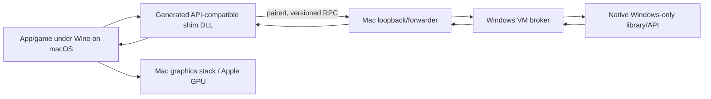
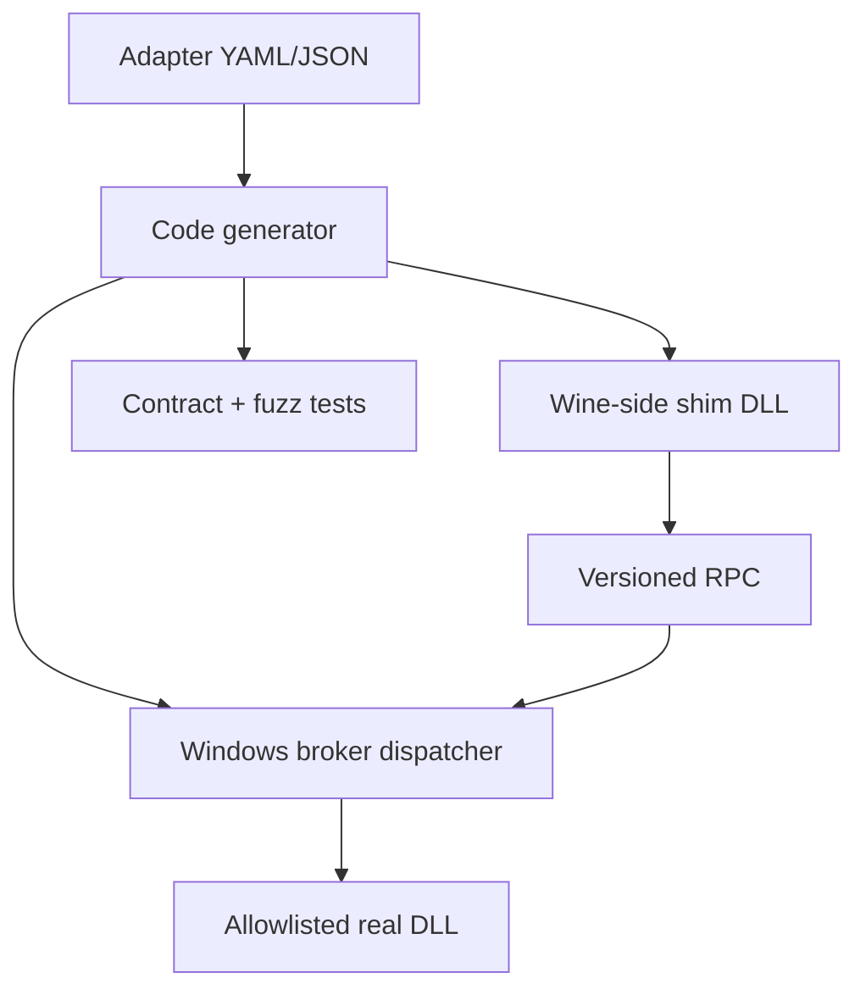

# Architecture

## Responsibility split



The bridge is an API coprocessor. It does not move rendering or the complete
application into Windows.

“Paired” is transport access control: setup creates a random capability known
to the Mac client and Windows broker. It is not application-user or online
account authentication.

## Generic DLL model

The broker never accepts an arbitrary DLL path or export from an untrusted
request. Setup installs an allowlisted adapter manifest. The generated shim
knows the ABI; requests identify only the installed adapter and operation.



## Contract requirements

Every adapter defines:

1. accepted request shape and maximum sizes;
2. native call and required Windows authority;
3. response shape and sensitive-field handling;
4. async completion and cancellation behavior;
5. remote handle ownership, expiry, close, and restart invalidation;
6. exact error mapping;
7. tests for malformed input, stale handles, replay, and disconnect.

An ABI manifest is mandatory. A DLL binary alone does not describe pointer
ownership, structure packing, callbacks, calling convention, or handle
lifecycle reliably enough for transparent remoting.

## Proven game operation

```mermaid
sequenceDiagram
    participant AF as Actual Abiotic Factor
    participant RT as Wine runtime adapter
    participant VM as Windows broker
    AF->>RT: XUserAddAsync(silent)
    RT->>VM: negotiate
    VM-->>RT: version / epoch
    RT->>VM: acquire user
    Note over VM: Native Windows user;<br/>may already be signed in
    VM-->>RT: S_OK + opaque session
    RT-->>AF: async completion S_OK
    AF->>RT: XUserAddResult
    RT-->>AF: S_OK
```

Warm path: about 13 ms from game API entry to game result. Independent broker
processing for user acquisition was about 1.5 ms. Mac and guest clocks were not
synchronized, so cross-machine timestamp subtraction is not used.

## Not Steamac

Steamac runs the application inside a Linux VM and forwards virtualized graphics
to the Mac GPU. This project keeps the application under Wine on the Mac and
remotes selected Windows API calls. They solve different problems.
