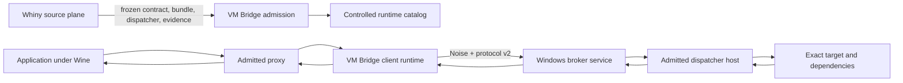
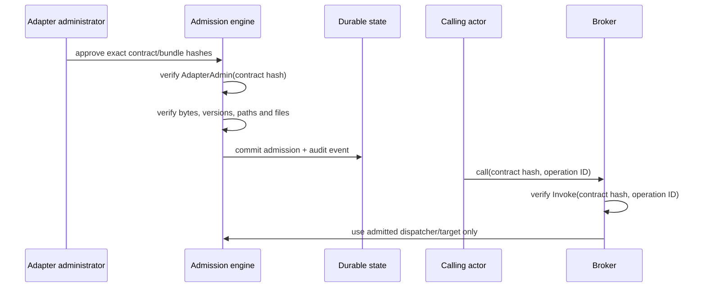

# Runtime architecture

## Product boundary

Whiny owns inspection, semantic evidence, canonical contract/IR, dependency
placement, freezing and every generated artifact. VM Bridge owns execution.
There is no second contract implementation in this repository.

## Frozen artifact admission

The current boundary identifiers are:

- `whiny.frozen-adapter-handoff.v1`;
- `whiny.authority-registry.v1`;
- `whiny.adapter-contract.v3`;
- `whiny.adapter-bundle.v1`;
- `whiny.dispatch.v1`;
- `whiny.correlated-runtime-expectations.v1`;
- `whiny.correlated-runtime-admission.v1`;
- `whiny.runtime-receipt.v1`.

The v2.5 consumer is pinned to Whiny revision
`c48db610ef2e9505b0fbc577a76704a1214bc83f`. It binds the canonical handoff,
registry entry, contract, bundle, deterministic build receipt, dispatcher,
provider, candidate, operation/schema IDs, side-effect policy, challenge
policy, acceptance command, source revision and custody boundary. It does not
generate, qualify or repair any of them.

An admitted bundle is not trusted because it was generated. Admission requires
an independently authorized operator and verifies:

1. exact contract and bundle descriptor bytes and SHA-256 values;
2. exact contract, bundle and dispatcher ABI identifiers and majors;
3. exactly one dispatcher and target;
4. every target and dependency hash;
5. a bounded operation set;
6. portable controlled relative paths;
7. no path traversal, case collision, symlink, junction or reparse point;
8. canonical containment under the configured package root.

The verified paths are re-resolved and re-hashed before loading. The Windows
loader uses explicit package directories and secure `LoadLibraryEx` search
flags; ambient `PATH` and current-directory resolution are prohibited.

Admission and invocation are separate:

Bundle metadata cannot create an actor, role or grant.

The public Whiny v1 authority registry and handoff currently describe only
`development-only` evidence. Their challenge, sequence and correlation values
are `unsupported`, and correlated admission reports `runtime_support: false`.
VM Bridge may bind and retain that evidence, but an `Invoke` grant cannot turn
it into runtime authority. T16, T26 and T32 therefore remain unsupported, and
the older scalar bundles cannot traverse the v2.5 handoff until Whiny publishes
reviewed scalar authority, handoff and runtime-expectation artifacts with
supported pre-execution controls. The old v0.3 bundle path remains historical
compatibility, not a substitute for this missing authority.

## Runtime layers

### Wine/client side

- process-wide connection pool per broker identity;
- no blocking or network work in `DllMain`;
- bounded call and transfer queues;
- guarded ABI copies and exact error restoration;
- explicit callback executors;
- inherited sessions discarded after fork;
- OS-backed identity consumed without plaintext repository or registry secrets.

The failed CrossOver by-name unixlib experiment is not a supported
configuration path. A supported automatic configuration route must use a Wine
loader-initialized builtin DLL/unixlib handle or another documented mechanism;
it must not call the rejected private memory-information-class path unchanged.

### Transport/session

- framed TCP with `TCP_NODELAY`;
- Noise pairing and application sessions;
- HELLO/HELLO_ACK feature and bound negotiation;
- odd client stream IDs and independent multiplexed streams;
- bounded physical fragments and logical payloads;
- replay windows and actor-scoped rate limits;
- truthful timeout, cancellation and disconnect outcomes.

### Windows broker

- least-privileged service account;
- exact package ACLs;
- durable SQLite WAL state and bounded writers;
- separate liveness, readiness and diagnostics;
- actor/operation authorization on every dispatch;
- controlled native/CLR/process hosts;
- worker isolation and Job Object process-tree containment;
- startup reconciliation for admissions, operations and terminal receipts.

### Lifecycle

- transfers require begin/data/end, content hash and a terminal receipt;
- handles are bound to actor, epoch, slot, generation and type;
- callbacks enforce executor, thread, ordering, reentrancy and unregister rules;
- the first completion/cancellation terminal decision wins;
- disconnect during an executing non-idempotent operation produces
  `unknown`, never fabricated success or cancellation;
- process requests bound argv, environment, stdin, stdout and stderr and retain
  exact exit/timeout/cancellation results.

## Durable evidence

Runtime-changing operations have a durable operation UUID, actor, target hash,
timestamps, stage, attempt, idempotency hash, retry/cancel/rerun policy, trace
ID and terminal receipt. Events and receipts are hash chained. A trusted
rollback anchor remains independent of broker database metadata.

Before execution, a Runtime Owner attempt binds a nonzero workload, attempt and
receipt ID; exact host, bundle and operation; request and expected-response
hashes; immutable authorization-receipt and challenge hashes; and a monotonic
sequence. Terminal completion must match every prebound value. Assigning any of
them after execution is invalid rather than recoverable evidence.

`whiny.runtime-receipt.v1` defines the cross-product receipt format. VM Bridge
owns runtime emission, retention, privacy and query behavior; it does not own
Whiny build or semantic-evidence receipts.

## Package lifecycle

Unsigned packages have deterministic canonical manifests with exact source,
SBOM and file hashes. Installation uses inactive version slots:

1. verify and stage into a controlled temporary directory;
2. verify every copied file;
3. atomically finalize the version;
4. run health checks before activation;
5. retain the previous active slot for rollback;
6. refuse removal of the active slot;
7. expose exact uninstall impact before deletion.

Authenticode and notarization are separate external receipts. No signing secret
is stored in the repository or materialized by the runtime.

Bootstrap launchers are distributed and authenticated separately from runtime
archives. They are not embedded in the package they verify, avoiding a
self-authentication trust loop. The trusted launcher verifies the release
envelope before executing the envelope-bound lifecycle binary.

## Topology acceptance

The canonical topology remains Wine on macOS calling the Windows VM broker over
the approved forwarded TCP path. Shared memory, vsock, gRPC replacement, GUI
remoting, kernel/driver execution and anti-cheat bypass are not part of v2.

The isolated `Whiny-Windows11-x64` VM is the preferred acceptance target.
Acceptance automation must verify its UUID and readiness, record or snapshot
pre-state, use dedicated paths/rules/processes, and restore temporary changes.
The official Windows-RPC VM and unrelated VMs are never modified.

## Runtime Owner and host selection

The Runtime Owner API exposes typed install, activate, rollback, execute,
receipt-query and diagnostic operations only. Host discovery reports immutable
capability observations. Selection prefers compatible local Windows ARM64 work
and routes authoritative or x64-only profiles to authoritative Windows x64.

Workload UUID, attempt UUID, selected host, bundle hash and terminal receipt ID
are correlated in durable VM Bridge operation state. This does not extend the
Whiny receipt schema or move campaign policy, semantic interpretation or
generation into VM Bridge.
